# Compose DND

A library that allows you to easily add drag and drop functionality to your Jetpack Compose or Compose Multiplatform projects.

[](http://kotlinlang.org)
[](https://www.jetbrains.com/lp/compose-multiplatform)
[](https://opensource.org/licenses/Apache-2.0)
[](https://github.com/MohamedRejeb/compose-dnd/actions)
[](https://search.maven.org/search?q=g:%22com.mohamedrejeb.dnd%22%20AND%20a:%22compose-dnd%22)

<picture>
  <source media="(prefers-color-scheme: dark)" srcset="docs/images/demos/kanban.gif">
  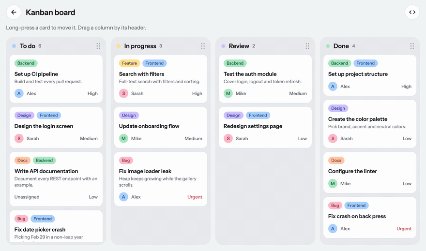
</picture>

**[Try the live demo](https://mohamedrejeb.github.io/compose-dnd/demo/)** · **[Documentation](https://mohamedrejeb.github.io/compose-dnd/)** · **[Sample app](sample/common/src/commonMain/kotlin/ui)**

- **One API for every platform** -- Android, iOS, desktop and web share the same code.
- **Just modifiers** -- add `draggableItem`, `dropTarget` or `reorderableItem` to the composables you already have.
- **Works inside scrollables** -- long press to drag, auto scroll at the edges, lazy lists and grids.
- **You own the data** -- the library reports what happens, your state decides what changes.

<div align="center"><a href="https://github.com/Safouene1/support-palestine-banner/blob/master/Markdown-pages/Support.md"></a></div>

## What you can build

Every clip below is a screen of the [sample app](sample/common/src/commonMain/kotlin/ui). Click one to open its guide.

<table>
  <tr>
    <td align="center" width="33%">
      <a href="https://mohamedrejeb.github.io/compose-dnd/drag-and-drop/overview/">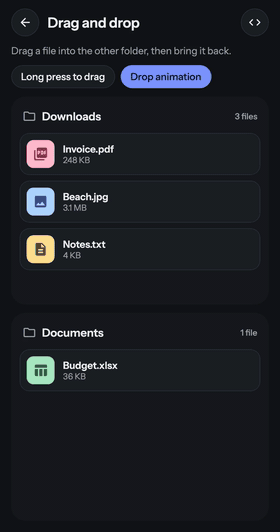<br><b>Drag and drop</b></a><br>
      <sub><code>draggableItem</code> + <code>dropTarget</code></sub>
    </td>
    <td align="center" width="33%">
      <a href="https://mohamedrejeb.github.io/compose-dnd/drag-and-drop/reorder/">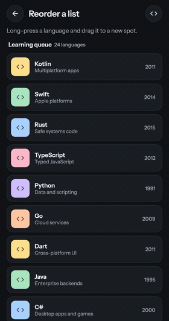<br><b>Reorder a list</b></a><br>
      <sub><code>reorderableItem</code></sub>
    </td>
    <td align="center" width="33%">
      <a href="https://mohamedrejeb.github.io/compose-dnd/drag-and-drop/drag-handle/">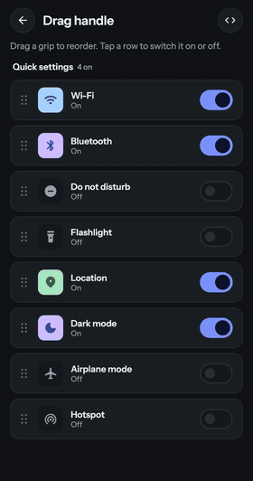<br><b>Drag handle</b></a><br>
      <sub>Only the grip starts the drag</sub>
    </td>
  </tr>
  <tr>
    <td align="center" width="33%">
      <a href="https://mohamedrejeb.github.io/compose-dnd/drag-and-drop/kanban-board/">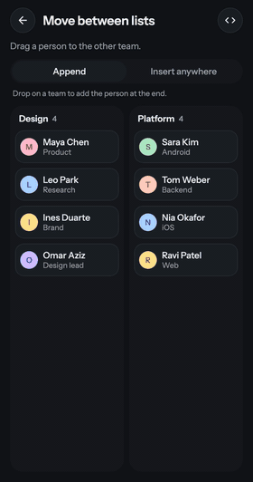<br><b>Move between lists</b></a><br>
      <sub>One state, many lists</sub>
    </td>
    <td align="center" width="33%">
      <a href="https://mohamedrejeb.github.io/compose-dnd/drag-and-drop/auto-scroll/">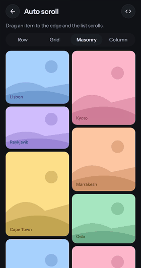<br><b>Auto scroll</b></a><br>
      <sub>Lists, grids and staggered grids</sub>
    </td>
    <td align="center" width="33%">
      <a href="https://mohamedrejeb.github.io/compose-dnd/drag-and-drop/kanban-board/">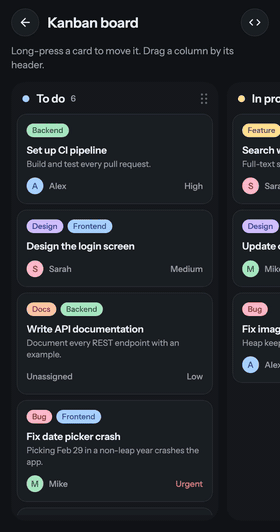<br><b>Scroll across columns</b></a><br>
      <sub>Auto scroll on both axes</sub>
    </td>
  </tr>
  <tr>
    <td align="center" width="33%">
      <a href="https://mohamedrejeb.github.io/compose-dnd/drag-and-drop/multi-select/">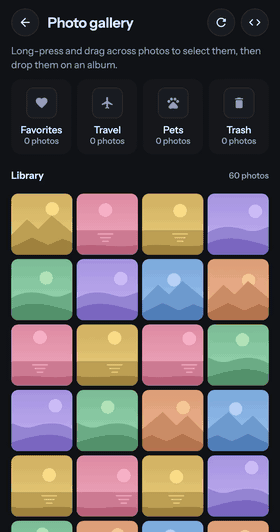<br><b>Drag to select</b></a><br>
      <sub>Then drag the selection as a group</sub>
    </td>
    <td align="center" width="33%">
      <a href="https://mohamedrejeb.github.io/compose-dnd/drag-and-drop/free-form/">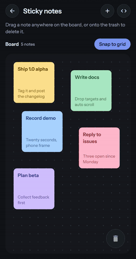<br><b>Free-form placement</b></a><br>
      <sub>Drop anywhere, snap to a grid</sub>
    </td>
    <td align="center" width="33%">
      <a href="https://mohamedrejeb.github.io/compose-dnd/drag-and-drop/form-builder/">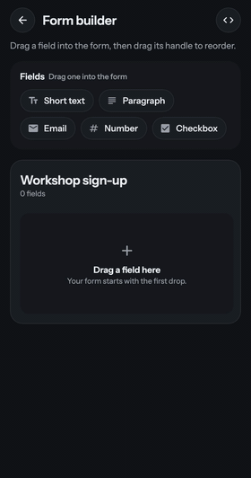<br><b>Copy on drop</b></a><br>
      <sub>A palette that keeps its items</sub>
    </td>
  </tr>
  <tr>
    <td align="center" width="33%">
      <a href="https://mohamedrejeb.github.io/compose-dnd/drag-and-drop/conditional-drop/">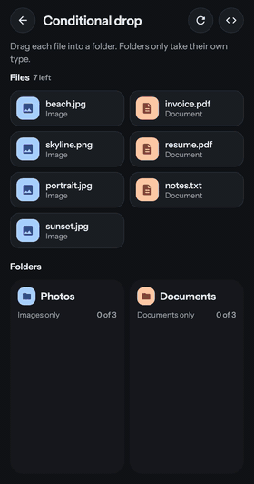<br><b>Conditional drop</b></a><br>
      <sub>Targets choose what they accept</sub>
    </td>
    <td align="center" width="33%">
      <a href="https://mohamedrejeb.github.io/compose-dnd/drag-and-drop/drop-strategies/">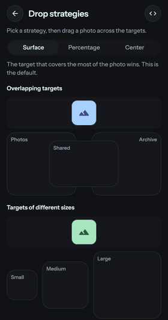<br><b>Drop strategies</b></a><br>
      <sub>Pick the target under the item</sub>
    </td>
    <td align="center" width="33%">
      <a href="https://mohamedrejeb.github.io/compose-dnd/drag-and-drop/axis-lock/">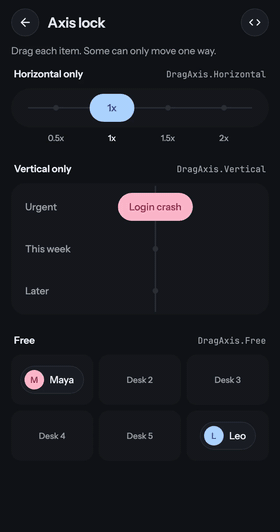<br><b>Axis lock</b></a><br>
      <sub>Horizontal or vertical only</sub>
    </td>
  </tr>
</table>

## Features

- **Drag and Drop** -- Drag items from one location and drop them onto designated targets
- **Reorder Lists** -- Reorder items within a list, a grid, or across several lists
- **Auto Scroll** -- Scroll lazy lists, grids, staggered grids and scrollable containers when an item is held near an edge, in any layout direction
- **Drag to Select / Multi-Select** -- Extend a selection by dragging across items, then drag the whole selection as a group
- **Free-Form Placement** -- Drop items anywhere on a board, with the drop animation landing exactly where they snap
- **Drop Strategies** -- Choose which drop target wins when the dragged item covers several, or write your own
- **Drag Handle** -- Restrict the drag gesture to a specific handle area within the item
- **Axis Lock** -- Constrain dragging to the horizontal or vertical axis
- **Conditional Drop** -- Control which drop targets accept which dragged items
- **Long Press to Drag** -- Keep taps and scrolling working on draggable items
- **Drag Lifecycle Callbacks** -- `onDragStart` and `onDragEnd` on every draggable item, so you can persist state once per drag
- **Drop Animation** -- Smooth spring-based animations when items are dropped
- **Custom Drag Shadow** -- Provide a custom composable to display while an item is being dragged

## Platform Support

| Platform   | Supported |
|------------|-----------|
| Android    | Yes       |
| iOS        | Yes       |
| Desktop    | Yes       |
| Web (JS)   | Yes       |
| Web (WASM) | Yes       |

## Installation

[](https://search.maven.org/search?q=g:%22com.mohamedrejeb.dnd%22%20AND%20a:%22compose-dnd%22)

### Version Compatibility

| Kotlin version | Compose version | Compose DND version |
|----------------|-----------------|---------------------|
| 2.3.20         | 1.10.3          | 1.0.0-alpha01       |

Add the following dependency to your module `build.gradle.kts` file:

```kotlin
implementation("com.mohamedrejeb.dnd:compose-dnd:1.0.0-alpha01")
```

For Kotlin Multiplatform projects, add the dependency to your `commonMain` source set:

```kotlin
kotlin {
    sourceSets {
        commonMain.dependencies {
            implementation("com.mohamedrejeb.dnd:compose-dnd:1.0.0-alpha01")
        }
    }
}
```

> `1.0.0-alpha01` is the first 1.0 alpha. It deprecates `ReorderState`, `rememberReorderState`, and `ReorderContainer` in favor of `DragAndDropState` everywhere -- see the [migration guide](https://mohamedrejeb.github.io/compose-dnd/migration-1.0/) if you're upgrading from `0.5.0`.

## Usage

### Drag and Drop

Create a `DragAndDropState`, wrap your content with `DragAndDropContainer`, and use the `draggableItem` and `dropTarget` modifiers:

```kotlin
val dragAndDropState = rememberDragAndDropState<String>()

DragAndDropContainer(
    state = dragAndDropState,
) {
    val isDragging = dragAndDropState.isDragging("item-1")

    Text(
        text = "Drag me",
        modifier = Modifier
            .graphicsLayer { alpha = if (isDragging) 0f else 1f }
            .draggableItem(
                key = "item-1",
                data = "Hello",
                state = dragAndDropState,
                draggableContent = {
                    Text("Drag me") // Shown as the drag shadow
                },
            ),
    )

    Box(
        modifier = Modifier
            .dropTarget(
                key = "target-1",
                state = dragAndDropState,
                onDrop = { state ->
                    println("Dropped: ${state.data}")
                },
            )
    ) {
        Text("Drop here")
    }
}
```

### Reorder List

The `reorderableItem` modifier makes an item both draggable and a drop target, which is all a sortable list needs:

```kotlin
val dndState = rememberDragAndDropState<String>()

DragAndDropContainer(
    state = dndState,
) {
    LazyColumn {
        items(items, key = { it }) { item ->
            Text(
                text = item,
                modifier = Modifier
                    .graphicsLayer { alpha = if (dndState.isDragging(item)) 0f else 1f }
                    .reorderableItem(
                        key = item,
                        data = item,
                        state = dndState,
                        onDragEnter = { state ->
                            items = items.toMutableList().apply {
                                val index = indexOf(item)
                                if (index != -1) {
                                    remove(state.data)
                                    add(index, state.data)
                                }
                            }
                        },
                        draggableContent = {
                            Text(item)
                        },
                    ),
            )
        }
    }
}
```

### Enable/Disable Drag and Drop

Toggle drag and drop at the container level:

```kotlin
DragAndDropContainer(
    state = dragAndDropState,
    enabled = false,
) { }
```

Or for a specific item by passing `enabled = false` to the `draggableItem` or `reorderableItem` modifier.

> Prefer wrapping composables instead of modifiers? The `DraggableItem` and `ReorderableItem` wrapper composables offer the same features - see the [documentation](https://mohamedrejeb.github.io/compose-dnd/).

> For more details and advanced features (auto scroll, drop strategies, drag handles, axis lock), check out the [documentation](https://mohamedrejeb.github.io/compose-dnd/) and the [sample project](https://github.com/MohamedRejeb/compose-dnd/tree/main/sample/common/src/commonMain/kotlin).

## Contribution

If you've found an error in this library, please file an [issue](https://github.com/MohamedRejeb/compose-dnd/issues).

Feel free to help out by sending a pull request.

[Code of Conduct](https://github.com/MohamedRejeb/compose-dnd/blob/main/CODE_OF_CONDUCT.md)

## Find this library useful?

Support it by joining [stargazers](https://github.com/MohamedRejeb/compose-dnd/stargazers) for this repository.

Also, [follow me](https://github.com/MohamedRejeb) on GitHub for more libraries!

You can always buy me a coffee:

<a href="https://www.buymeacoffee.com/MohamedRejeb"></a>

## License

```
Copyright 2023 Mohamed Rejeb

Licensed under the Apache License, Version 2.0 (the "License");
you may not use this file except in compliance with the License.
You may obtain a copy of the License at

   http://www.apache.org/licenses/LICENSE-2.0

Unless required by applicable law or agreed to in writing, software
distributed under the License is distributed on an "AS IS" BASIS,
WITHOUT WARRANTIES OR CONDITIONS OF ANY KIND, either express or implied.
See the License for the specific language governing permissions and
limitations under the License.
```
